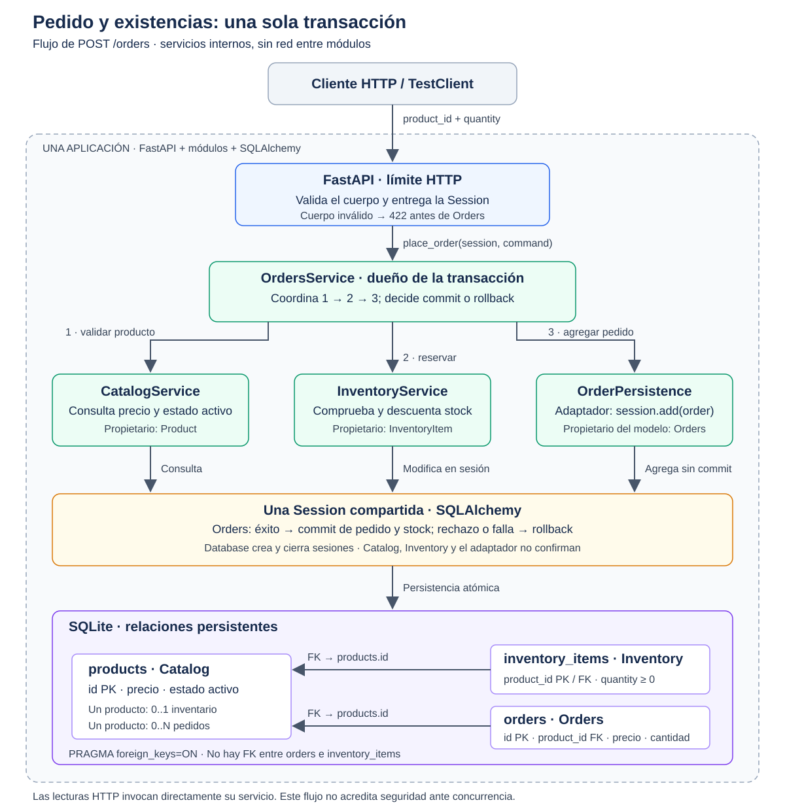

# Monolito modular de pedidos

API de pedidos con FastAPI, SQLAlchemy y SQLite. Su objetivo es confirmar un pedido y su descuento de existencias como una sola operación: si falla la creación, no debe quedar stock descontado sin pedido. Catalog, Inventory y Orders son módulos internos de una única aplicación, no servicios independientes.

## Integrantes

- Juan David Velasquez Murillo
- Paula Andrea Calderon Quintero
- Alejandra Madrid Calderon
- Sara Regino Ferraro

## Instalación y ejecución

Se utiliza Python 3.14 y dependencias fijadas en [requirements-dev.txt](requirements-dev.txt), que incluye los [requisitos de ejecución](requirements.txt). Desde la raíz del proyecto, en Linux/macOS:

```bash
python3 -m venv .venv
source .venv/bin/activate
python -m pip install -r requirements-dev.txt
python -m scripts.init_db
python -m uvicorn app.main:create_app --factory --host 127.0.0.1 --port 8000
```

En Windows PowerShell, crear el entorno con `python -m venv .venv` y activarlo con `.\.venv\Scripts\Activate.ps1`; los comandos posteriores son iguales. Para ejecutar sin pruebas, instalar solo `requirements.txt`.

La inicialización crea el esquema y agrega únicamente los registros sintéticos ausentes. No restablece existencias ya consumidas. Sin `DATABASE_URL`, se utiliza `runtime/lab02.db`; puede seleccionarse otra base SQLite mediante esa variable. La documentación interactiva está en `http://127.0.0.1:8000/docs`.

## Solicitudes de ejemplo

Con una base recién inicializada, el producto `product-active` está activo, cuesta `12.50` y tiene 10 unidades. `product-zero` está activo sin existencias y `product-inactive` está inactivo con 4 unidades.

Desde otra terminal:

```bash
curl -sS http://127.0.0.1:8000/health
curl -sS http://127.0.0.1:8000/products
curl -sS http://127.0.0.1:8000/inventory/product-active
curl -sS -i -X POST http://127.0.0.1:8000/orders \
  -H 'Content-Type: application/json' \
  -d '{"product_id":"product-active","quantity":3}'
curl -sS http://127.0.0.1:8000/inventory/product-active
```

Resultados esperados: salud `{"status":"ok"}`, inventario inicial `10`, pedido HTTP `201` con cantidad `3` y precio `12.50`, e inventario final `7`. El identificador y la fecha del pedido se generan en ejecución; usar el identificador recibido en `GET /orders/{order_id}`.

```bash
curl -sS -i -X POST http://127.0.0.1:8000/orders \
  -H 'Content-Type: application/json' \
  -d '{"product_id":"product-active","quantity":0}'
curl -sS -i -X POST http://127.0.0.1:8000/orders \
  -H 'Content-Type: application/json' \
  -d '{"product_id":"product-zero","quantity":1}'
curl -sS -i -X POST http://127.0.0.1:8000/orders \
  -H 'Content-Type: application/json' \
  -d '{"product_id":"product-inactive","quantity":2}'
```

Estos rechazos devuelven `422`, `409` y `409`, respectivamente, sin crear pedidos ni descontar existencias.

## Rutas HTTP

| Método y ruta | Respuesta correcta | Errores previstos |
|---|---|---|
| `GET /health` | `200`, estado `ok` | — |
| `GET /products` | `200`, lista de productos | — |
| `GET /inventory/{product_id}` | `200`, existencias | `404`, inventario inexistente |
| `POST /orders` | `201`, pedido confirmado | `422`, cuerpo inválido; `404`, producto inexistente; `409`, producto inactivo o stock insuficiente; `500`, falla de persistencia |
| `GET /orders/{order_id}` | `200`, pedido | `404`, pedido inexistente |

## Arquitectura



Orders coordina la consulta de Catalog, la reserva de Inventory y la persistencia del pedido con una misma `Session`. Orders decide el `commit` final o el `rollback`; Database crea y cierra sesiones. Los módulos colaboran mediante servicios internos, sin llamadas HTTP entre ellos.

Consultar la [arquitectura detallada](docs/arquitectura.md) y la [fuente Mermaid](diagramas/arquitectura.mmd).

## Pruebas

```bash
python -m pytest -q -p no:cacheprovider
python -m pytest -q -p no:cacheprovider \
  tests/test_orders_integration.py::test_persistence_failure_rolls_back
```

La suite contiene cinco pruebas: pedido correcto, stock insuficiente, producto inactivo, falla de persistencia tras reservar y cantidad inválida por HTTP. Cada prueba utiliza SQLite temporal; no usa la base de ejecución. Las fixtures usan `active-product`, no el identificador `product-active` de los ejemplos. La [estrategia de pruebas](docs/estrategia_pruebas.md) describe sus comprobaciones y límites.

## Limitaciones

El alcance es local y acotado: no hay autenticación, pagos, interfaz gráfica, colas ni servicios externos. Los cinco casos no acreditan concurrencia, carga, seguridad integral ni disponibilidad de producción. La falla técnica se inyecta en una prueba de integración, no mediante un endpoint artificial. `/health` informa disponibilidad de la aplicación, no una comprobación profunda de la base de datos.
